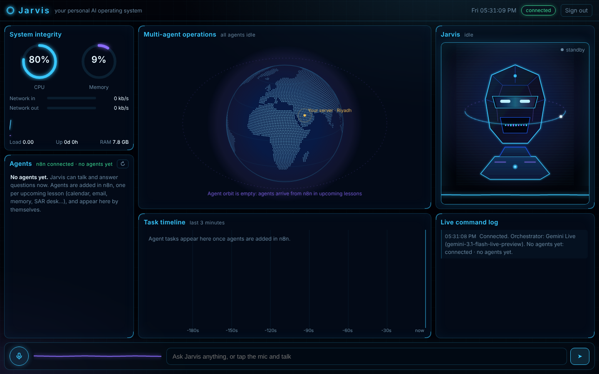
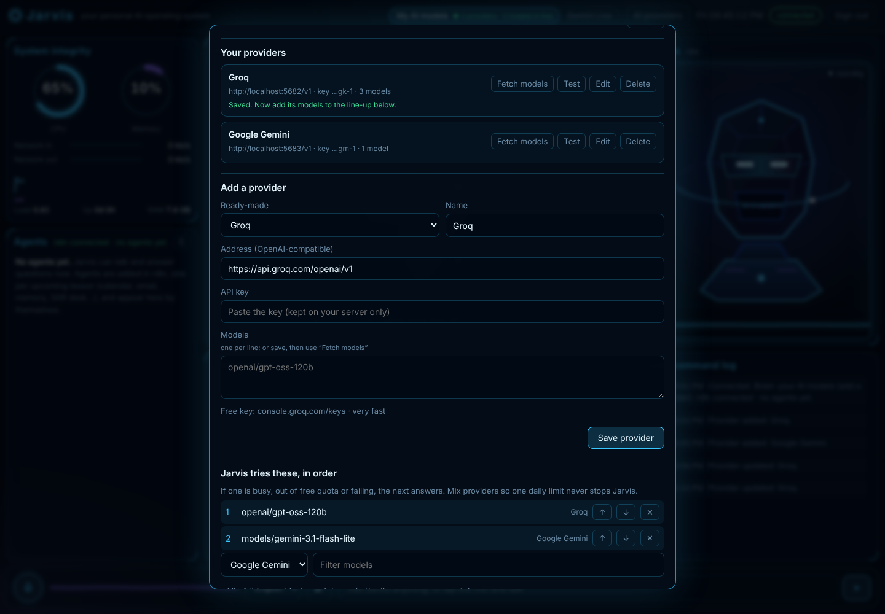

# Lesson 09 — Jarvis Live: the dashboard of your personal AI operating system

**Goal:**
- Open one screen and **talk** to Jarvis (or type). Its main brain is **your AI models**: providers you add yourself on the dashboard (Groq, Google Gemini, OpenRouter, NVIDIA, Mistral, Bifrost or any OpenAI-compatible service). **Gemini Live** is there for real-time voice calls.
- See an animated AI sentinel answer you, a globe with your server, live server health, and a command log.
- Connect the dashboard to the **n8n** you installed in Lesson 06, so that every **agent** you build in upcoming lessons appears here and can be used by voice.

**This lesson adds no agents.** Today Jarvis can talk and answer general questions, through the free models you add. Actions such as your calendar, email, SAR desk or your PC come one per lesson, built in n8n.

**Time:** about 40 minutes. **Cost:** $0. **Before you start:** Lessons 06–07 are done (n8n online, Telegram bot working).

**Status:** ⚠️ Written. Tested locally in a browser with a stand-in n8n:
- sign-in, live metrics, the sentinel's three states
- your own AI providers and models, added and ordered on the dashboard
- Jarvis answering through them, and calling an n8n agent when one exists
- the empty agent list, and agents appearing by themselves when n8n lists them
- alerts, and desktop and phone layouts

Real voice calls need your server and Google: the first call happens there.



---

## Part A — The architecture (built for what's coming)

```
 you: text, or speech ──► Jarvis dashboard (browser): sentinel · globe + agent orbit · timeline · system · log
                                  │                                          ▲ live events
              ┌───────────────────┴─────────────────────┐                    │
   Brain 1: YOUR AI MODELS (default)           Brain 2: GEMINI LIVE          │
   providers you add, fallback in your order   real-time voice call,         │
   (Lesson 05) · text + push-to-talk           interruptions                 │
              └──────────── both call the same agents ──┘                    │
                                  ▼                                          │
                     jarvis-live (small server on your VM) ──────────────────┘
                     • keeps every provider key and the Gemini key on the server
                     • server health + alerts by itself
                     • asks n8n: "which agents exist?" / "do this task"
                                  ▼
                     n8n (Lesson 06) — workflow "Jarvis agents"
                     • Agent list ........ empty today; one agent per upcoming lesson
                     • any workflow can push events back to the dashboard
```

**The two brains:**

| Brain | How you talk | Why |
|---|---|---|
| **My AI models** (default, pick it at the top) | Type, or tap the mic and speak: your browser turns speech into text (English or Urdu). The reply is shown and read aloud | Uses the providers and models **you add** under *AI providers*, tried in your order |
| **Gemini Live** | Tap the mic for a real-time call: talk back and forth, interrupt it | The most natural voice conversation |

**Why agents live in n8n, not in the dashboard:**
- **You build them in n8n's web page.** That's the rule of this course: no code changes to add a skill.
- **One brain, every door.** The same agent can serve the voice dashboard, Telegram Jarvis (Lesson 07) and scheduled routines.
- **The dashboard follows by itself.** When n8n's agent list changes, the globe, the roster and Jarvis's tools update. Click **↻** to check at once.

**Future goals this design is ready for:**

| Coming | What it adds | Where it plugs in |
|---|---|---|
| Lesson 10 · First agent: Reminders | "Remind me at 9", ask-first rule, alerts spoken here | n8n *Agent list* + branches |
| Lesson 11 · Calendar, email, web search | "What's on today?" | n8n agents |
| Lesson 12 · Memory (RAG) | Jarvis remembers preferences, past talks, documents | a `memory` agent in n8n |
| Lesson 13 · Routines | Morning briefing, SAR desk alerts, spoken by Jarvis | n8n schedules + events to the dashboard |
| Lessons 14–16 · Laptop hands | "Open my QA report" on your PC | a `laptop` agent: n8n → OpenJarvis |
| Later · premium brain | Claude for hard jobs, only when you choose | add it under *AI providers* (Jarvis) or pick it in an n8n agent |

## Part B — The dashboard

| Where | Panel | What it shows |
|---|---|---|
| Top left | **System integrity** | CPU and memory rings, network in and out, a short history, load, uptime, RAM, from the real server |
| Below | **Agents** | Whether **n8n is connected**, and the agents it lists. Today: *No agents yet* |
| Center | **Multi-agent operations** | A dotted holographic globe with **your server** marked, inside an empty **agent orbit**. Each agent you add takes a place on it; a working agent glows and fires an arc to the server |
| Below | **Task timeline** | Gantt chart of the last 3 minutes of agent tasks |
| Top right | **Jarvis** | The **AI sentinel**, described below |
| Below | **Live command log** | What you said, what Jarvis said, agent steps and alerts, time-stamped |
| Top bar | **Brain switch** | **My AI models** (with its status, e.g. *● 2 providers · 3 models in line*) or **Gemini Live** |
| Top bar | **AI providers** | Add, edit, test and delete providers; choose and order their models (Part E2) |
| Bottom | **Command bar** | Mic, waveform, language (English or اردو) for speech, 🔊 read replies aloud on/off, text input |

Drag the thin lines between panels to resize; the layout is remembered. On a phone, the panels stack.

### Jarvis's avatar: the AI sentinel


An original design for this course: a faceted helm floating in an orbit ring.

| State | What you see |
|---|---|
| **Idle / listening** | It hovers. The visor's eyes glance around and blink, then look at you while you speak |
| **Thinking** | A digital ripple runs across it, the visor scans, and the orbit speeds up |
| **Speaking** | The voice-grille bars move with Jarvis's real voice: louder sounds raise them, sharper sounds spread them outward. A waveform runs below |

It doesn't copy any film character: their designs belong to their studios.

## Part C — Install (one command, on the server over SSH)

```bash
curl -fsSLO https://raw.githubusercontent.com/ahmadbilal2011/free-ai-lab/main/scripts/09-install-live.sh
bash 09-install-live.sh
```

It asks for three things:
1. Your **Gemini API key**: free from aistudio.google.com/apikey, from a project without billing. It's typed hidden and checked with Google.
2. A **page password** (12+ characters, hidden). It's stored only as a hash.
3. Your first name, which is how Jarvis addresses you.

AI providers are **not** asked here: you add them on the dashboard in Part E2.

**Expected tests at the end:**

| Test | Expected |
|---|---|
| `https://live-…sslip.io/` | **200** (sign-in page) |
| token without sign-in | **401** |
| `http://<ip>:8090` | **000** (not public) |
| `/api/event` from the internet | **403** (only n8n inside the server may push events) |
| n8n → jarvis-live | **yes** |
| jarvis-live → n8n agents | **404** before Part D, **200** after it |

It also prints the **Jarvis secret** for Part D. Keep the terminal open.

## Part D — Connect n8n (import one workflow)

1. n8n → **Credentials → Create → Header Auth**. Name `X-Jarvis-Secret`, Value = the Jarvis secret from the installer. Save it as `Jarvis Live secret`.
2. Download [`stacks/jarvis/workflows/jarvis-agents.json`](../stacks/jarvis/workflows/jarvis-agents.json) to your laptop.
3. n8n → **Create workflow → ⋯ (top right) → Import from File** → choose it.
4. In both webhook nodes (*Jarvis asks: which agents?* and *Jarvis asks: do this task*), set the Credential to `Jarvis Live secret`.
5. **Publish** the workflow.
6. On the dashboard, click **↻** next to *Agents*. It should say **n8n connected · no agents yet**.

What's inside:
- **Agent list** answers `{ "agents": [] }`, which is empty for now.
- **Do this task** answers "no agent set up yet".

Each upcoming lesson adds one entry to the list, for example `{ "id": "calendar", "name": "Calendar", "role": "meetings and reminders", "color": "#b388ff" }`, plus that agent's branch.

## Part E — First talk

1. Open `https://live-<your-ip-with-dashes>.sslip.io` on your phone or PC and sign in. The top bar says **My AI models ● add a provider**. Do Part E2 first, then come back to step 2.

### Part E2 — Add your AI providers and models (as many as you want)



Click **AI providers** (top right). Everything about models is managed here; nothing needs the terminal.

**Add a provider**

1. **Ready-made**: choose one (Groq, Google Gemini, OpenRouter, NVIDIA Build, Mistral, Cerebras, SambaNova, Cohere, Cloudflare, Bifrost) or **Other (custom)**. The name and address fill in, and a line tells you where to get the free key.
2. **API key**: paste it. It's saved on your server only (`~/lab/live/data/providers.json`, readable by root only). The browser later sees only its last 4 characters.
3. **Models**: leave empty, or type model names, one per line.
4. Click **Save provider**.

**Get its models**

5. On the provider's row click **Fetch models**: Jarvis asks the provider for its model list. If a provider has no list, click **Edit** and type the model names yourself.
6. Click **Test**: it should say *Works: … replied "ready" in … ms*. *HTTP 401* means the key is wrong (Edit → paste it again).

**Put models in line**

7. Under *Jarvis tries these, in order*, choose the provider, filter (e.g. `70b`, `flash`, `:free`), and click **Add** on each model you want.
8. Order them with ↑ ↓; remove with ✕. Changes save at once.

Jarvis tries the line **top to bottom**: if one is busy, out of free quota or failing, the next answers, and the log says so. Hover over a reply to see every model it tried.

Tip: put a **fast** model first (Groq), then a **big** one, then models from **other providers** (Gemini Flash-Lite, OpenRouter `:free`), so that one daily limit never stops Jarvis.

| Provider | Address to use | Notes |
|---|---|---|
| Groq | `https://api.groq.com/openai/v1` | free, very fast |
| Google Gemini | `https://generativelanguage.googleapis.com/v1beta/openai` | key from a project without billing |
| OpenRouter | `https://openrouter.ai/api/v1` | use models ending in `:free` |
| Bifrost (Lesson 05) | `http://bifrost:8080/v1` | key = a Bifrost virtual key; optional |
| Anything else | its OpenAI-compatible address | must be `https://`; `http://` only for services inside your server |

Edit or delete any provider at any time from the same screen. Deleting one also removes its models from the line.

**Talk with your models:**

2. Type *"Hi Jarvis, who are you?"* and press Enter. The sentinel thinks (ripple), then the answer appears and is read aloud. Hover over the answer to see which model replied.
3. Choose **اردو** next to the mic, tap the mic and say *"آج کا دن کیسے منظم کروں؟"*. Your words appear in the log, then Jarvis answers.
4. Ask for an action, such as *"What's on my calendar?"*. Jarvis should say that skill arrives when its agent is added. It must **not** make up an answer.

**With Gemini Live:**

5. Click **Gemini Live** at the top, tap the mic and allow the microphone. Talk back and forth, and interrupt it mid-sentence: it stops and listens. Tap again to end.

> Speech-to-text in *My AI models* mode is done by your browser (Chrome, Edge, Android and Safari support it). The read-aloud voice is your device's own. Urdu read-aloud needs an Urdu voice on the device; otherwise the text still shows.

## Part F — Events: n8n can make Jarvis speak up

Any n8n workflow (now or later) can add an **HTTP Request** node:

| Field | Value |
|---|---|
| Method / URL | POST `http://jarvis-live:8080/api/event` (private network) |
| Authentication | Generic → Header Auth → `Jarvis Live secret` |
| Body (JSON) | `{ "type": "alert", "text": "Backup finished", "speak": true }` |

- **Alerts** show in amber in the log. During a call, Jarvis mentions them out loud.
- **Agent work on the timeline:** `{ "agent": "<id>", "status": "start" or "done", "task": "…" }` shows that agent's work.
- **Agent list changed:** `{ "refresh": true }` makes the dashboard ask n8n for the list again.

The server also watches itself: memory above 85% or CPU above 90% for a minute → an alert.

## Part G — Security

| Lock | What it stops |
|---|---|
| HTTPS + page password (scrypt hash) + fail2ban (5 tries / 10 min → 1 h ban) | Strangers using your Jarvis |
| Provider keys and the Gemini key stay on the server; browsers get one-time Gemini tokens and only the last 4 characters of provider keys | Key theft from a phone or browser |
| Jarvis can only call agents that n8n lists; every call carries the secret | Jarvis being tricked into random actions |
| `/api/event` blocked from the internet | Fake alerts from outside |
| Container read-only, no extra rights, 128 MB, server stats read-only | A bug harming the server |

## Commands

| Command | What it does |
|---|---|
| `bash 09-install-live.sh` | Update (asks only for what's missing) |
| `bash 09-install-live.sh --password` | Change the page password |
| `bash 09-install-live.sh --off` | Stop it and take the page offline |
| `LIVE_MODEL=<name> bash 09-install-live.sh` | Force another Gemini Live model |
| Dashboard → **AI providers** | Add, test, edit and delete providers; order their models (saved in `~/lab/live/data`, included in backups) |
| `docker logs --tail 30 jarvis-live` | Errors and agent calls |

## If something goes wrong

| Problem | Fix |
|---|---|
| Top bar says *add a provider* or *pick models* | Open **AI providers**: add one, then add its models to the line |
| **Test** says *HTTP 401* | Wrong key: **Edit** the provider and paste the key again |
| **Test** says *HTTP 404* or *model not found* | The model name is wrong for that provider: use **Fetch models** or check its docs |
| **Fetch models** fails | Some providers have no model list: **Edit** and type model names yourself |
| A reply says *None of your models answered* | Every model in the line failed (quota, keys). Add models from another provider |
| Bifrost provider fails | `docker ps` should show `bifrost` running (Lesson 05); address `http://bifrost:8080/v1` |
| Mic does nothing in *My AI models* mode | The browser has no speech-to-text: use Chrome or Edge, type instead, or switch to Gemini Live |
| Agents says *n8n not reachable* | `docker ps` should show `n8n` healthy; both containers must be on the `jarvis` network (the installers do this) |
| Agents says *workflow isn't published yet* | Part D: import and **Publish** "Jarvis agents" |
| Agents says *n8n refused the Jarvis secret* | The Header Auth value in n8n differs from `N8N_TOOL_SECRET` in `~/lab/live/.env` |
| "Couldn't start voice: Google answered 4xx" | Key or model not allowed. Re-run the installer and send me its *Token test* line |
| Voice link closes at once (code 1007/1008) | `docker logs jarvis-live`, then `LIVE_MODEL=<another> bash 09-install-live.sh` |
| Header shows *reconnecting…* | It retries by itself; if it stays, check `docker ps` shows `jarvis-live` healthy |
| No microphone prompt | Open over **https**; browser site settings → Microphone → Allow |
| Jarvis hears itself | Use earphones or lower the volume |

## Next

[Lesson 10 — First agent: Reminders](10-first-agent-reminders.md). Agents come one lesson at a time, all in n8n. Each one appears on this dashboard by itself the moment you publish it.
