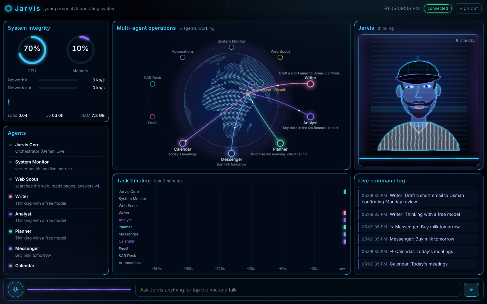
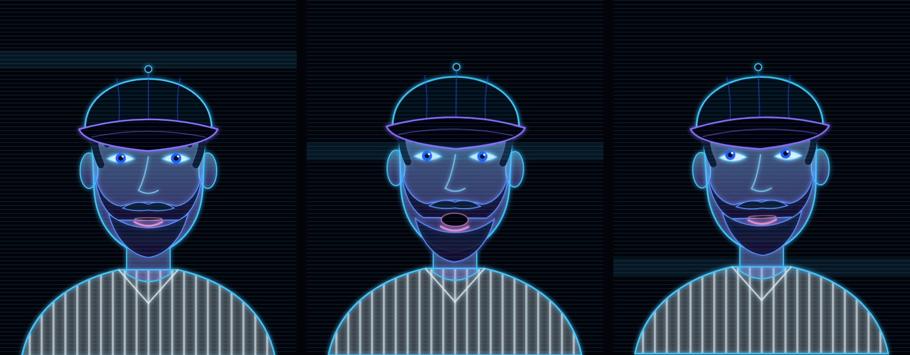

# Lesson 09 — Jarvis Live: your personal AI operating system (digital twin, agents, live voice)

**Goal:** one screen where you **talk** to Jarvis (or type) and **watch** it work:
- a holographic **digital twin** of you speaks the answers
- a **globe** shows your server, with **agents** orbiting it
- working agents light up and fire arcs into the globe
- a live timeline, server health and a command log run alongside

The agents **do real tasks**: search the web, write, analyse, plan, message your Telegram, and anything else you connect in n8n.

**Time:** about 45 minutes. **Cost:** $0. **Before you start:** Lessons 05–07 are done (Bifrost with a `smart` virtual key, n8n online, Telegram bot working).

**Status:** ⚠️ Written. Tested locally in a browser with stand-in AI and n8n services:
- sign-in, live metrics, the twin's three states, the globe
- six agents working in parallel, with their results coming back
- alerts, and desktop and phone layouts

Real voice calls and real model answers need your server: the first run happens there.



---

## Part A — The architecture

```
 you: voice + text ──► Jarvis dashboard (browser): twin · globe of agents · timeline · system · log
          ▲   │ voice both ways, straight to Google              ▲ live events (metrics, agent steps, alerts)
          │   ▼                                                  │
   Gemini Live API (free) = ORCHESTRATOR ──tool calls──► jarvis-live server (on your VM)
   hears you, decides, calls agents                     ├─ System Monitor ........ built in (real CPU/RAM/network)
   (several at once), speaks the result                 ├─ Web Scout · Writer ·    AI agents on your free models
                                                        │  Analyst · Planner ....  through Bifrost (Lesson 05)
                                                        ├─ Messenger · Calendar ·  n8n agents: one imported workflow,
                                                        │  Email · SAR Desk ·      one branch per agent
                                                        │  Automations
                                                        └─ event loop: watches the server, accepts events from n8n
```

| Your requirement | How it's built |
|---|---|
| **Orchestrator + specialised agents** | **Gemini Live** (free) is the orchestrator. It calls `ask_agent(agent, task)`, several agents at once when a request has several parts. **AI agents** run on your free models through Bifrost. **Integration agents** are n8n workflows. **Claude** can be added later as a paid premium model in Bifrost: the agents switch with one setting (`AGENT_MODEL`). |
| **Real-time event loop** | The server streams events to every open screen: metrics every 2 s, every agent start, step, finish and failure, and alerts. It watches the server by itself (memory above 85% or CPU above 90% for a minute → alert). Any n8n workflow can push events; with `"speak": true`, Jarvis says them out loud during a call. |
| **Voice + text** | Full-duplex voice: you can interrupt Jarvis mid-sentence, and both sides are transcribed live. Typed commands go into the same conversation. |
| **Long-term memory (RAG)** | Lesson 17 adds a `memory` agent (vector database + embeddings). The dashboard needs no change. |

## Part B — The dashboard

| Where | Panel | What it shows |
|---|---|---|
| Top left | **System integrity** | CPU and memory rings, network in and out, a short history line, load, uptime, RAM, all from the real server |
| Below | **Agents** | Every agent, its job, and what it's doing right now |
| Center | **Multi-agent operations** | A dotted holographic globe with **your server** marked. The agents sit on an orbit ring; a working agent glows, an arc with a travelling pulse connects it to the server, and its task shows under its name |
| Below | **Task timeline** | Gantt chart of the last 3 minutes: one row per agent, one bar per task, red if it failed |
| Top right | **Jarvis** (digital twin) | A vector hologram of you: black cap, beard, white striped shirt. **Idle/listening:** breathes, blinks, glances, then looks at you. **Thinking:** digital ripple, eyes drift up. **Speaking:** the mouth opens with the voice's loudness and goes wide or round with its pitch, with a live waveform below |
| Below | **Live command log** | What you said, what Jarvis said, each agent step, and alerts, time-stamped |
| Bottom | **Command bar** | Mic (start/end voice), waveform, text input |

Drag the thin lines between panels to resize; the layout is remembered. On a phone, the panels stack.



> **About the twin:** it is drawn, not a photo, so nothing about your face is uploaded anywhere. Its mouth
> follows the real voice, but it is not frame-perfect lip-sync: that needs a GPU, which the free server doesn't have.

## Part C — Install (one command, on the server over SSH)

```bash
curl -fsSLO https://raw.githubusercontent.com/ahmadbilal2011/free-ai-lab/main/scripts/09-install-live.sh
bash 09-install-live.sh
```

It asks for four things, typed hidden where secret:
1. **Gemini API key**: free from aistudio.google.com/apikey, from a project without billing. It's checked with Google.
2. **Page password** (12+ characters). It's stored only as a hash.
3. Your first name, which is how Jarvis addresses you.
4. **Bifrost virtual key** for the AI agents: your `smart` key from Lesson 05. Press Enter to skip for now.

**Expected tests at the end:**

| Test | Expected |
|---|---|
| `https://live-…sslip.io/` | **200** (sign-in page) |
| token without sign-in | **401** |
| `http://<ip>:8090` | **000** (not public) |
| `/api/event` from the internet | **403** (only n8n inside the server may push events) |
| n8n → jarvis-live | **yes** |
| jarvis-live → Bifrost | **yes** (AI agents can reach your free models) |

It also prints the **Jarvis secret** for Part E. Keep the terminal open.

## Part D — Try the AI agents right away

These work as soon as the install finishes, with no n8n needed. Open the dashboard, tap the mic (or type), and say:
- *"Jarvis, search the web: what's the latest on Oracle Cloud's free tier?"* → **Web Scout** searches, reads 3 pages, and answers with sources
- *"Write a short WhatsApp message to my team: Monday review moved to 11."* → **Writer**
- *"Plan my morning: client call at 10, QA report, SAR transfers."* → **Planner**
- *"How is the server doing?"* → **System Monitor**
- *"Plan my morning **and** find the latest PKR news."* → Planner and Web Scout work **at the same time** on the globe and timeline

## Part E — n8n agents: import one workflow

1. n8n → **Credentials → Create → Header Auth**: Name `X-Jarvis-Secret`, Value = the Jarvis secret from the installer. Save it as `Jarvis Live secret`.
2. Download [`stacks/jarvis/workflows/jarvis-live-tools.json`](../stacks/jarvis/workflows/jarvis-live-tools.json) to your laptop.
3. n8n → **Create workflow → ⋯ (top right) → Import from File** → choose it.
4. Open **From Jarvis** (Webhook) → Credential → `Jarvis Live secret`.
5. Open **Messenger: send to Telegram** → Credential `Jarvis bot`. In **Chat ID**, replace `PUT-YOUR-TELEGRAM-ID-HERE` with your ID (from Lesson 07).
6. **Publish** the workflow.

Test: *"Jarvis, send me on Telegram: buy milk tomorrow."* → Messenger lights up and the message arrives.

| Branch | Now | Later |
|---|---|---|
| Messenger | ✅ sends to your Telegram | — |
| Calendar, Email | "not connected yet" | Lesson 16 (Google Calendar / Gmail nodes) |
| SAR Desk | "not connected yet" | Lesson 18 (rates, new requests) |
| Automations | "not connected yet" | call any of your workflows by name |

To make a branch real: replace its **Reply: not built yet** link with your nodes, ending in a **Respond to Webhook** that returns `{ "ok": true, "result": "…" }`. Jarvis speaks the result.

## Part F — Events: Jarvis speaks without being asked

Any n8n workflow can add an **HTTP Request** node:

| Field | Value |
|---|---|
| Method / URL | POST `http://jarvis-live:8080/api/event` (private network) |
| Authentication | Generic → Header Auth → `Jarvis Live secret` |
| Body (JSON) | `{ "agent": "sar", "type": "alert", "text": "New SAR request: 2,500 SAR", "speak": true }` |

- **Alert:** shown in amber in the log. During a call, Jarvis mentions it out loud.
- **Show work on the globe and timeline:** send `{ "agent": "sar", "status": "start", "task": "Checking rates" }`, then the same with `"status": "done"` and `"detail"`.

## Part G — Security

| Lock | What it stops |
|---|---|
| HTTPS + page password (scrypt hash) + fail2ban (5 tries / 10 min → 1 h ban) | Strangers using your Jarvis |
| Gemini key stays on the server; browsers get one-time tokens (1 minute to start) | Key theft from a phone or browser |
| Agents only from a fixed list; n8n calls carry a secret | Jarvis being tricked into random actions |
| `/api/event` blocked from the internet | Fake alerts from outside |
| Bifrost key only inside the container; agents' answers come from your own free models | Key leaks; surprise bills |
| Container read-only, no extra rights, 128 MB, server stats read-only | A bug harming the server |

Web Scout reads public web pages: it only fetches what a search returns, never logs in anywhere, and sends nothing from your conversation except the search words.

## Commands

| Command | What it does |
|---|---|
| `bash 09-install-live.sh` | Update (asks only for what's missing) |
| `bash 09-install-live.sh --password` | Change the page password |
| `bash 09-install-live.sh --off` | Stop it and take the page offline |
| `LIVE_MODEL=<name> bash 09-install-live.sh` | Force another Gemini Live model |
| Edit `AGENT_MODEL` in `~/lab/live/.env`, then re-run | Change the agents' model (e.g. a Claude model in Bifrost later) |
| `docker logs --tail 30 jarvis-live` | Errors and agent calls |

## If something goes wrong

| Problem | Fix |
|---|---|
| "Couldn't start voice: Google answered 4xx" | Key or model not allowed. Re-run the installer and send me its *Token test* line |
| Voice link closes at once (code 1007/1008) | `docker logs jarvis-live`, then `LIVE_MODEL=<another> bash 09-install-live.sh` |
| AI agent: "need a Bifrost key" | Re-run the installer and paste the `smart` virtual key |
| AI agent: "Bifrost answered 401/404" | Wrong key, or the model name isn't in Bifrost: check `AGENT_MODEL` and Bifrost's Models page |
| Web Scout: "search returned nothing" | Search sites can block servers. Try again later, or give it a URL to read ("read https://…") |
| n8n agent: "HTTP 404" | The imported workflow isn't **published** |
| n8n agent: "HTTP 403" | The Header Auth value differs from `N8N_TOOL_SECRET` in `~/lab/live/.env` |
| Header shows *reconnecting…* | It retries by itself; if it stays, check `docker ps` shows `jarvis-live` healthy |
| No microphone prompt | Open over **https**; browser site settings → Microphone → Allow |
| Jarvis hears itself | Use earphones or lower the volume |

## Next

Make the n8n agents real, one lesson each: **Calendar and Email** (16), **memory / RAG** (17), **SAR Desk and routines** (18).
Telegram Jarvis can use the same agents later, so both doors share one brain.
