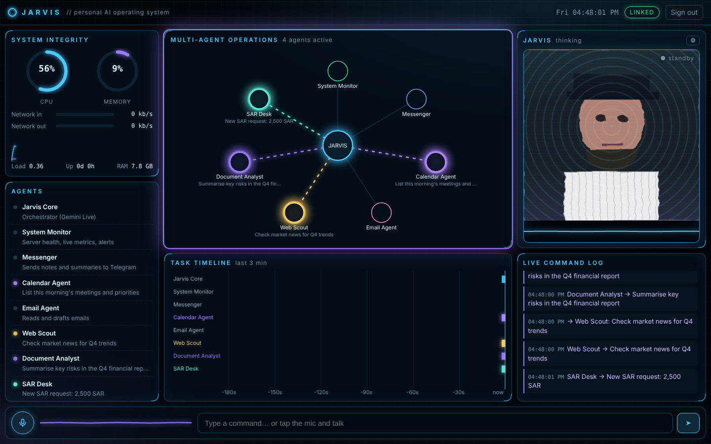

# Lesson 09 — Jarvis Live: the holographic dashboard (voice, agents, live events, your avatar)

**Goal:** one screen, your personal AI operating system. You talk to Jarvis (or type), and you **watch** it work:

- your own photo as Jarvis's animated avatar
- agents lighting up as they take on tasks
- a live timeline of what each agent is doing
- the server's health
- a command log

Jarvis can also speak up **by itself** when something happens.

**Time:** about 45 minutes. **Cost:** $0. **Before you start:** Lessons 06–07 are done (n8n online, Telegram bot working).

**Status:** ⚠️ Written. The dashboard was tested locally in a browser (screenshots below): sign-in, live metrics, agent graph and timeline, alerts, avatar upload, desktop and phone layouts. Real voice calls need your server and Google: the first call happens there.



---

## Part A — The architecture

```
                         ┌──────────────── Jarvis dashboard (your browser) ────────────────┐
  you: voice + text ───► │ avatar · agent graph · timeline · system integrity · command log │
                         └───┬───────────────────────────┬─────────────────────────────▲───┘
            voice, both ways │ (straight to Google)      │ tool calls                  │ live events
                             ▼                           ▼                             │ (metrics, agents, alerts)
                 Gemini Live API (free)        jarvis-live server ─────────────────────┘
                 = ORCHESTRATOR: listens,      • one-time Gemini tokens (key stays on the server)
                 thinks, decides which         • System Monitor agent (built in, reads real CPU/RAM/network)
                 agents to call                • event loop: watches the server, alerts by itself
                                               • forwards agent tasks ──► n8n "Jarvis Live tools" workflow
                                                                           ├─ Messenger (Telegram)
                                                                           ├─ Calendar · Email · Web Scout
                                                                           ├─ Document Analyst · SAR Desk
                                                                           └─ any n8n workflow can PUSH events back
```

How your four requirements are covered:

| Requirement | How |
|---|---|
| **1. Orchestrator + specialised agents** | **Gemini Live** is the orchestrator (free). It calls agents through one tool, `ask_agent(agent, task)`, several at once when a request has several parts. Agents are n8n workflows; the System Monitor is built in. **Claude** can be added later as a paid "premium" brain inside agents, through Bifrost (Lesson 05), without changing the dashboard. |
| **2. Real-time event loop** | The server streams events to every open screen (Server-Sent Events): metrics every 2 seconds, every agent start, finish and failure, and alerts. It **watches the server by itself** (memory above 85% or CPU above 90% for a minute → alert). Any n8n workflow can push an event; with `"speak": true`, Jarvis says it out loud during a call. |
| **3. Voice + text** | Full-duplex voice: you can interrupt Jarvis mid-sentence, and both sides are transcribed live. The bottom bar takes typed commands into the same conversation. |
| **4. Long-term memory (RAG)** | Its own lesson (Lesson 17): a vector database with your preferences, past conversations and documents, exposed as one more agent (`memory`). The dashboard needs no change for it. |

**Honest limits**
- **Lip movement:** the avatar is **your photo, animated in the browser**. It breathes, gets a digital ripple while thinking, and its jaw and a waveform move with Jarvis's real voice. That is not true lip-sync: realistic talking-head models need a GPU, which the free server doesn't have.
- **Agents:** the dashboard shows all eight agents from day one, but only **System Monitor** and **Messenger** do real work after this lesson. Calendar, Email, Web Scout, Document Analyst and SAR Desk answer "not built yet" until their lessons (16–18). Each is one more branch in the same n8n workflow.
- **Preview models:** Gemini Live models are previews; Google can change them. The installer picks one your key can use.
- **Free tier:** limited minutes and parallel calls, enough for one person. Google ends a call after a while; tap the mic again.
- **Privacy:** the free tier may use conversations to improve Google's products. **No SAR customer data** in live calls.

## Part B — The dashboard, panel by panel

| Where | Panel | What it shows |
|---|---|---|
| Top left | **System Integrity** | CPU and memory rings, network in and out, a 3-minute history line, load, uptime, RAM, all from the real server |
| Below it | **Agents** | Every agent, its role, and what it's doing now (blinking dot = working) |
| Center | **Multi-Agent Operations** | A network graph: Jarvis in the middle, agents around it. Active agents glow, their links pulse, and their current task appears under them |
| Below it | **Task Timeline** | A Gantt chart of the last 3 minutes: one row per agent, one bar per task, red if it failed |
| Top right | **Jarvis** (avatar) | Your photo, live. **Idle/listening:** slow breathing. **Thinking:** digital ripple. **Speaking:** jaw and waveform follow the voice |
| Below it | **Live Command Log** | What you said, what Jarvis said, agent steps, alerts, all time-stamped |
| Bottom | **Command bar** | Mic button (start/end voice), live waveform, text input |

Drag the thin lines between panels to resize them; the layout is remembered. On a phone, the panels stack.

## Part C — Install (one command, on the server over SSH)

```bash
curl -fsSLO https://raw.githubusercontent.com/ahmadbilal2011/free-ai-lab/main/scripts/09-install-live.sh
bash 09-install-live.sh
```

It asks for three things:
1. Your **Gemini API key**: free from aistudio.google.com/apikey, from a project **without billing**. It's typed hidden and checked with Google.
2. A **page password** (12+ characters, hidden). It's stored only as a hash.
3. Your first name, which is how Jarvis addresses you.

Then it picks the Live model, checks one-time tokens, builds the small container, gets the HTTPS certificate,
publishes `https://live-<ip>.sslip.io`, and adds a fail2ban jail.

**Expected tests at the end:**

| Test | Expected |
|---|---|
| `https://live-…sslip.io/` | **200** (sign-in page) |
| token without sign-in | **401** |
| `http://<ip>:8090` | **000** (not public) |
| `/api/event` from the internet | **403** (only n8n, inside the server, may push events) |
| n8n → jarvis-live | **yes** |

It also prints the **Jarvis secret** for Part E. Keep the terminal open.

## Part D — Your avatar

1. Open the dashboard and sign in.
2. Click **⚙** in the Jarvis window → **Upload your photo**:
   - front-facing, face in the upper half, good light
   - JPG, PNG or WebP, up to 6 MB
3. A green line appears: use **Mouth height**, **Mouth left/right** and **Mouth width** to place it on your lips. That's where the jaw opens when Jarvis speaks.
4. Click **⚙** again to close.

The photo is stored **only on your server** (`~/lab/live/data`, root-protected and included in the nightly backup). It never goes to GitHub or to Google.

## Part E — Agents in n8n: one workflow, one branch per agent

Jarvis sends every agent task to one n8n webhook with: `{ "tool", "agent", "task", "args" }`.

**1. Credential:** n8n → **Credentials → Create → Header Auth**. Name `X-Jarvis-Secret`, Value = the Jarvis secret
the installer printed. Save it as `Jarvis Live secret`.

**2. New workflow** `Jarvis Live tools`:

| # | Node | Settings |
|---|---|---|
| 1 | **Webhook** | POST · Path `jarvis-live-tool` · Authentication **Header Auth** → `Jarvis Live secret` · Respond: **Using 'Respond to Webhook' Node** |
| 2 | **Switch** (name it `Which agent`) | Value `{{ $json.body.agent }}`. Rules: `telegram`, `calendar`, `email`, `web`, `docs`, `sar` · Options → Fallback Output: *Extra Output* |
| 3 | **Telegram → Send a text message** (output `telegram`) | Credential `Jarvis bot` · Chat ID: your Telegram ID · Text `{{ $json.body.args.text }}` · Append n8n Attribution off |
| 4 | **Respond to Webhook** (after 3) | JSON `{ "ok": true, "result": "sent to Telegram" }` |
| 5 | **Respond to Webhook** (all other outputs, for now) | JSON, Expression: `{{ JSON.stringify({ ok: true, result: 'The ' + $json.body.agent + ' agent is not built yet.' }) }}` |

**Publish** it. Later lessons replace step 5 per agent. For example, the Calendar branch becomes *Google Calendar → AI summary → Respond*.

**Test by voice or text:**
- *"Jarvis, send me on Telegram: buy milk tomorrow."* → Messenger lights up, and the message arrives.
- *"Jarvis, how is the server doing?"* → System Monitor lights up, and Jarvis reads the real numbers.
- The spec's example: *"What are my priorities this morning, and the key risks in the Q4 report?"* → Calendar and Document Analyst light up **together** in the graph and timeline. For now they reply "not built yet", and Jarvis says so.

## Part F — Proactive events: Jarvis speaks without being asked

Any n8n workflow can tell the dashboard something happened. Add an **HTTP Request** node:

| Field | Value |
|---|---|
| Method / URL | POST `http://jarvis-live:8080/api/event` (inside the server, on the private network) |
| Authentication | Generic → Header Auth → `Jarvis Live secret` |
| Body (JSON) | `{ "agent": "telegram", "type": "alert", "text": "New Telegram message from Ahmad", "speak": true }` |

- `type: "alert"` shows the event in amber in the log. With `"speak": true`, Jarvis mentions it out loud during a voice call.
- To show agent work in the graph and timeline, send `{ "agent": "sar", "status": "start", "task": "Checking SAR rate" }`,
  then the same with `"status": "done"` (add `"detail"` for the result).

The **System Monitor** already does this by itself for high memory or CPU.

## Part G — Security

| Lock | What it stops |
|---|---|
| HTTPS + page password (scrypt hash) + fail2ban (5 tries / 10 min → 1 h ban) | Strangers using your Jarvis |
| Gemini key stays on the server; browsers get one-time tokens (1 minute to start) | Key theft from a phone or browser |
| Agents only via n8n with a secret; Jarvis can only call agents on the list | Jarvis being tricked into random actions |
| `/api/event` blocked from the internet; n8n uses the private network + secret | Fake alerts from outside |
| Container: read-only, no extra rights, 128 MB, port 8090 server-only; server stats read-only | A bug in the page harming the server |
| Avatar photo only on your server, root-protected, never on GitHub | Your face leaking |

## Commands

| Command | What it does |
|---|---|
| `bash 09-install-live.sh` | Update (asks only for what's missing) |
| `bash 09-install-live.sh --password` | Change the page password (signs everyone out) |
| `bash 09-install-live.sh --off` | Stop it and take the page offline |
| `LIVE_MODEL=<name> bash 09-install-live.sh` | Force another Live model |
| `docker logs --tail 30 jarvis-live` | See errors and agent calls |

## If something goes wrong

| Problem | Fix |
|---|---|
| "Couldn't start voice: Google answered 4xx" | Key or model not allowed. Re-run the installer and send me its *Token test* line |
| Voice link closes at once with a code (1007/1008) | Model or setup refused: `docker logs jarvis-live`, then `LIVE_MODEL=<another> bash 09-install-live.sh` |
| Header shows **reconnecting** | The event stream dropped. It retries by itself; if it stays, `docker ps` should show `jarvis-live` healthy |
| System Integrity shows 0% everywhere | `docker exec jarvis-live ls /host/proc/stat` must exist; re-run the installer |
| No microphone prompt | Open the page over **https**; browser site settings → Microphone → Allow |
| Jarvis hears itself | Use earphones or lower the volume |
| Agent says "n8n answered HTTP 404" | The `Jarvis Live tools` workflow isn't **published**, or the path isn't `jarvis-live-tool` |
| Agent says "HTTP 403" | The Header Auth value in n8n differs from `N8N_TOOL_SECRET` in `~/lab/live/.env` |
| Mouth moves in the wrong place | ⚙ → move the green line onto your lips |

## Next

Make the agents real, one per lesson: **Calendar and Email** (16), **memory / RAG** (17), **SAR Desk and routines** (18).
Each adds a branch to `Jarvis Live tools`, and both Telegram Jarvis and Live Jarvis use it.
